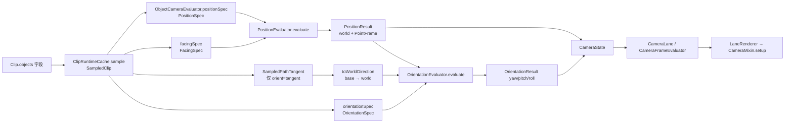

# 相机位置 / 朝向配置的运行时语义研究报告

> 研究对象：Minecraft 主模组仓库 `E:\Documents\GitHub\ImmersiveCinematics`（不是 Editor 仓）。
> 研究方式：只读 Java 源码，沿「JSON 字段 → 采样 → 规格对象 → 向量变换 → `Camera.setup`」追踪；未运行构建、测试或游戏。
> 源码路径口径：下文 `JAVA/` = `common/src/main/java/com/immersivecinematics/immersive_cinematics/`；行号从 1 起。
> 结论口径：标「事实」的条目可由所引代码直接验证；标「推断 / 未确认」的条目单独说明。

---

## 0. 一页结论

1. 位置配置不是「片段级静态开关」。`position_mode`、`position_space`、`position_origin`、`facing_source` 都是 `ANIMATED + STEP` 字段，运行时每帧采样，所以同一片段可以在关键帧上切换模式 / 空间 / 方向源（`JAVA/script/schema/TrackSchemas.java:119-136`，`JAVA/camera/source/ObjectCameraEvaluator.java:311-338`）。
2. `absolute` 在运行时直接返回 `(x, y, z)` 世界坐标，`position_space`、`position_origin`、`facing_*` 全部不参与；`ObjectCameraEvaluator.positionSpec` 在 absolute 时把 origin 设为 `null`（`JAVA/camera/source/ObjectCameraEvaluator.java:313-320`，`JAVA/script/object/position/PositionEvaluator.java:62-64`）。
3. `absolute + base` / `absolute + 非空 position_origin` 只在 `/icinematics validate` 或编辑器校验 API 里报「错误级 issue」，不是加载门禁；运行时静默忽略，不抛异常、不打印 warning（`JAVA/script/object/ObjectValidator.java:500-515`，`JAVA/script/ScriptValidator.java:45-76,299`，`JAVA/command/CinematicCommand.java:336-337`，`JAVA/editor/shared/WebEditorApi.java:161-163`）。
4. `relative + world`：世界坐标 = 原点 + 世界轴偏移 `(x, y, z)`；默认原点 = **玩家激活位置**（脚本激活时固定，整场不变），不是实时玩家位置（`JAVA/script/object/position/PositionEvaluator.java:72-76`，`JAVA/script/object/position/PointSourceSpec.java:60-72`，`JAVA/script/object/position/WorldContext.java:15`）。
5. `relative + base`：世界坐标 = 原点 + `fwd * x + up * y + right * z`；默认原点 = **隐式 `@p` 实体选择器**（取实时插值脚底中心），不是玩家激活位置（`JAVA/script/object/position/PositionEvaluator.java:78-90`，`JAVA/script/object/position/PointSourceSpec.java:63-68`）。
6. base 参考系是**水平系**：`up` 恒为世界 `+Y`；`fwd` / `right` 只取水平分量。`facing_source=entity` 只读实体身体 yaw（不读视线 pitch）；`facing_source=line` 只取原点→目标的水平方向（`JAVA/script/object/position/PositionEvaluator.java:42-44,154-194`）。
7. `facing_source=auto` 的真实回落顺序：`facing_target` → `facing_entity` → 原点形态；若两者同时非空则直接抛 `IllegalArgumentException`（`JAVA/script/object/position/PositionEvaluator.java:132-151`）。
8. 朝向优先级是：**`look_at` 可解析 → 路径切线 → 手动**。`look_at` 命中时 `yaw/pitch` 偏移和 `yaw_lock/pitch_lock` 都不参与；`yaw_offset/pitch_offset` 只在切线支参与（`JAVA/script/object/position/OrientationEvaluator.java:53-78`）。
9. `orient=tangent` 的切线只对 `position.x/y/z` 做中心差分，不包含 `position_origin` 的运动。原点在动、偏移恒定时切线为 0，会退回手动朝向；要跟运动目标应优先用 `look_at` 或路径绑定（`JAVA/script/object/position/SampledPathTangent.java:10-21,36-49,74-85`，`JAVA/camera/source/ObjectCameraEvaluator.java:433-457`）。
10. `roll` 不进入 `Camera.setRotation`；`CameraMixin` 只写 position / yaw / pitch，`roll` 由 lane 渲染在相机姿态之后绕视线轴追加（`JAVA/mixin/CameraMixin.java:63-72`，`JAVA/client/lane/LaneRenderer.java:641-646`）。
11. 最终画面相机是**每条 lane 自己的 `CameraState`**：脚本裁剪出的 lane 快照写入 `LaneRenderer.Lane.state`，再由 `CameraMixin` 拦截 `Camera.setup` 写入位置与旋转；全局链输出不是「主相机」（`JAVA/camera/source/CameraFrameEvaluator.java:144-153`，`JAVA/client/lane/LaneRenderer.java:551,585,631-646`）。
12. 校验器文案与运行时并非完全同源：`position_origin_freeze`、`look_at_freeze`、`yaw_base_from/to_freeze` 的「只在实体选择器时读取」提示与求值层实际行为不完全一致；`position_origin=player + base + facing_source=auto` 会被校验器接受，但运行时代码路径会抛异常。见第 7 节。

---

## 1. 运行期主链路

### 1.1 从脚本到每帧规格



事实：

- `ObjectCameraEvaluator.evaluate` 的执行顺序是：采样 → 组装 `PositionSpec` / `FacingSpec` / `OrientationSpec` → 位置求值 → （仅 tangent）切线求值 → 朝向求值 → 组装 `CameraState`（`JAVA/camera/source/ObjectCameraEvaluator.java:218-249`）。
- 位置求值先于朝向求值；位置不可解析时直接返回 `null`，本帧没有任何相机输出，朝向求值不会执行（`JAVA/camera/source/ObjectCameraEvaluator.java:228-232`）。
- `positionSpec` 从采样值读取 `position_mode` / `position_space` / `position_origin` / `position_origin_x/y/z` / `position_origin_freeze` / `position.x/y/z`（`JAVA/camera/source/ObjectCameraEvaluator.java:311-338`）。
- `facingSpec` 从采样值读取 `facing_source` / `facing_target(_x/_y/_z/_offset.*/_freeze)` / `facing_entity`（`JAVA/camera/source/ObjectCameraEvaluator.java:340-353`）。
- `orientationSpec` 读取 `yaw/pitch/roll`、`yaw_lock/pitch_lock`、`yaw_base/pitch_base`、`yaw_base_selector`、`yaw_base_from/to`、`look_at*`、`orient`、`yaw_offset/pitch_offset`（`JAVA/camera/source/ObjectCameraEvaluator.java:355-412`）。
- 槽位读取统一走「本时刻有值才用采样值，否则用 schema 缺省值」：`f()` / `b()` / `str()`（`JAVA/camera/source/ObjectCameraEvaluator.java:587-601`）。这解释了为什么「作者没写」与「写了 0」在运行期数值上相同，但 `present` 语义会区分。

### 1.2 路径绑定会先改写 `position.x/y/z`

脚本级路径绑定在构造 `PositionSpec` 之前覆盖被选中的轴：

- `pathBindings.position(...)` 给出路径位置；`binding.axes()` 为真的轴覆盖采样值，未选轴保留采样值（`JAVA/camera/source/ObjectCameraEvaluator.java:324-336`）。
- 切线同理：选中的轴取路径导数，未选轴取采样导数（`JAVA/camera/source/ObjectCameraEvaluator.java:447-457`）。

因此 `position_space=base` 时，路径绑定给出的数值也会被当作 `(fwd, up, right)` 分量，而不是世界坐标。Editor 若做「路径 + base 空间」预览，必须按这个口径解释，不能把路径值直接当世界坐标。

### 1.3 最终写入相机

- `ObjectCameraEvaluator` 产出 `CameraState(position.world(), yaw, pitch, roll, fov, zoom)`（`JAVA/camera/source/ObjectCameraEvaluator.java:243-244`）。
- `CameraFrameEvaluator.renderSingle` 再叠加该片段自己的 motion（`LaneMotionStepper`）与 breath，得到最终 lane 状态（`JAVA/camera/source/CameraFrameEvaluator.java:144-153,246-283`）。
- `CameraTrackPlayer` 把顶层片段写入全局状态，同时给 lane 快照（`JAVA/script/CameraTrackPlayer.java:139-159,177-180`）。
- lane 渲染时，`LaneRenderer` 把该 lane 的 `CameraState` 放到 `lane.state` / `activeLaneState`，然后调用 `camera.setup(...)`（`JAVA/client/lane/LaneRenderer.java:551,585,628-640`）。
- `CameraMixin` 在 `Camera.setup` 的 HEAD 拦截 lane 相机，调用 `setPosition(x,y,z)` 与 `setRotation(yaw,pitch)`，随后取消原版 setup（`JAVA/mixin/CameraMixin.java:56-75`）。
- `roll` 不进入 `setRotation`；`LaneRenderer` 在视图矩阵中先应用 `camera.getXRot()` / `camera.getYRot()+180`，再绕当前视线轴旋转 `-roll`（`JAVA/client/lane/LaneRenderer.java:641-646`）。
- Editor 直控预览时脚本轨迹不参与：`CameraTrackPlayer.onRenderFrame` 在 `cameraManager.isPreviewDirectControl()` 为真时直接返回（`JAVA/script/CameraTrackPlayer.java:106-107`）；编辑器直写走 `CameraManager.setCameraDirect`（`JAVA/camera/CameraManager.java:191,295-311`）。此时看到的相机不是本报告公式的求值结果。

单位与角度约定：

- 位置 = 世界空间方块坐标，1 单位 = 1 格（`JAVA/api/CameraState.java:8-15`）。
- `yaw` 度，0 = 南（+Z），90 = 西（-X）；`pitch` 度，0 = 水平，-90 = 正上（`JAVA/script/object/position/OrientationResult.java:3-7`，`JAVA/camera/source/CameraFrameEvaluator.java:24-35`）。
- MC 视线方向公式：`(-sin(yaw)·cos(pitch), -sin(pitch), cos(yaw)·cos(pitch))`（`JAVA/camera/source/CameraFrameEvaluator.java:28`）。

---

## 2. 位置：字段读取、模式分派与公式

### 2.1 字段缺省

`TrackSchemas.cameraObjects()` 的位置字段：

| 字段 | 类型 / 插值 | 缺省 | 证据 |
|---|---|---|---|
| `position.x/y/z` | FLOAT / LINEAR | `0` | `JAVA/script/schema/TrackSchemas.java:113-118` |
| `position_mode` | ENUM / STEP | `relative` | `JAVA/script/schema/TrackSchemas.java:119-120` |
| `position_space` | ENUM / STEP | `world` | `JAVA/script/schema/TrackSchemas.java:121-122` |
| `position_origin` | REF / STEP | 空串 | `JAVA/script/schema/TrackSchemas.java:123-124` |
| `position_origin_x/y/z` | FLOAT / LINEAR | `null` → 读取时 `0` | `JAVA/script/schema/TrackSchemas.java:125-130` |
| `position_origin_freeze` | BOOL / STEP | `false` | `JAVA/script/schema/TrackSchemas.java:131-132` |

运行期模式判定只做精确字符串匹配：

- `"absolute".equals(str)` → `ABSOLUTE`，否则 `RELATIVE`（`JAVA/camera/source/ObjectCameraEvaluator.java:313-314`）。
- `"base".equals(str)` → `BASE`，否则 `WORLD`（`JAVA/camera/source/ObjectCameraEvaluator.java:315-316`）。

事实：由于是 STEP 字段，`position_mode` / `position_space` 可以在关键帧上切换；运行时每次采样按当前时刻的值分派。校验器只对「切换点缺少 `position.x/y/z` 关键帧」提出 issue，不禁止切换（`JAVA/script/object/ObjectValidator.java:40-48,602-635`）。

### 2.2 `absolute`

```text
world = (x, y, z)
frame = null
```

证据：`PositionEvaluator.evaluate` 第一分支（`JAVA/script/object/position/PositionEvaluator.java:62-64`）。

- `x/y/z` 直接是世界坐标，没有原点、没有偏移合成。
- `position_space`、`position_origin`、`facing_source`、`facing_target`、`facing_entity` 都不参与。
- `ObjectCameraEvaluator.positionSpec` 在 absolute 时直接把 origin 设为 `null`（`JAVA/camera/source/ObjectCameraEvaluator.java:317-320`）。
- absolute 时即使 `position_space=base`，运行时仍然走 absolute 早退；`base` 不会改变结果（`PositionEvaluator.java:62-64`）。
- absolute 时 `orient=tangent` 仍可取切线；切线来自 `position.x/y/z` 的导数，`toWorldDirection` 只在 `RELATIVE + BASE` 时才做参考系变换，所以 absolute 下切线原样是世界方向（`JAVA/camera/source/ObjectCameraEvaluator.java:505-514`）。

### 2.3 `relative + world`

```text
O = resolve(position_origin)
world = O + (x, y, z)
frame = null
```

证据：`PositionEvaluator.java:72-76`。

- 默认原点（`position_origin` 为空）：`PointKind.WORLD` → `ctx.playerActivation()`，即脚本激活时玩家所在位置，整场不变（`PointSourceSpec.java:63-66`，`PositionEvaluator.java:204-209`，`WorldContext.java:15`）。
- 显式原点可以是 `coordinate` / 实体选择器 / `block:id[:radius]` / 结构 id；取点规则见 2.5。
- `facing_*` 在这个分支完全不读；即使写了也不会构建 `PointFrame`。
- `position_origin_freeze=true` 时冻结的是「原点 + 世界轴偏移」后的最终世界点，不是原点本身（`PositionEvaluator.java:73-74,244-251`）。

### 2.4 `relative + base`

```text
O = resolve(position_origin)
frame = buildFrame(O, facing, originSpec)
world = O + fwd*x + up*y + right*z
```

证据：`PositionEvaluator.java:78-90`。

三个必须记住的细节：

1. **参考系的原点是偏移前的原点**。`frame(origin, ...)` 用的是 `resolveSource` 得到的 `O`，此时还没有加 `(x,y,z)`（`PositionEvaluator.java:66-67,78`）。所以 `facing_source=line` 是「原点 → 目标」的水平方向，而不是「最终相机位置 → 目标」。
2. **参考系是水平的**。`entityFrame` 与 `lineFrame` 都返回 `up = (0,1,0)`，`forward` 只保留水平分量；实体视线 pitch、目标点的高度差都不影响基准轴（`PositionEvaluator.java:166-172,186-193`）。
3. **默认原点不是激活位置**。空 origin + `base` 时 `PointSourceSpec.positionOrigin` 生成 `SELECTOR` + `"@p"`，取实体选择器脚底点（`PointSourceSpec.java:63-68`）。它随玩家实时移动，与 `relative + world` 的空 origin 语义不同。
4. **默认方向源也不是 world**。空 origin（`SELECTOR @p`）+ 默认 `facing_source=auto` 会回落到 `ENTITY`，轴向 = 玩家身体 yaw（`PositionEvaluator.java:147-149`）。只有身体 yaw = 0 时，`fwd/right` 才分别等于 `+Z/-X`；玩家转向后 base 轴随之旋转。

### 2.5 `position_origin` 取点表

`PointKinds.kindOf` 的判据是唯一一份字符串分类（`JAVA/script/object/position/PointKinds.java:38-45`）：

| `position_origin` 值 | 形态 | 取点 | 证据 |
|---|---|---|---|
| 空串 + `world` | `PointKind.WORLD`（名字叫 WORLD，含义是玩家激活位置） | `playerActivation()` | `PointSourceSpec.java:63-66`，`PositionEvaluator.java:204-209` |
| 空串 + `base` | `SELECTOR` + `"@p"` | 实体包围盒内 `FOOT = (50,0,50)` | `PointSourceSpec.java:63-68` |
| `player` | `PointKind.WORLD` | `playerActivation()` | `PointSourceSpec.java:70-71,100-101` |
| `coordinate` | `COORDINATE` | `(position_origin_x, position_origin_y, position_origin_z)`，缺省都按 0 | `PointSourceSpec.java:102-103`，`ObjectCameraEvaluator.java:587-590` |
| `@...` / `uuid:...` | `SELECTOR` | 实体渲染帧插值位置 + 包围盒百分比点；默认 `FOOT` | `PointKinds.java:40`，`EntityTargetResolver.java:51-56` |
| `block:id[:radius]` | `BLOCK` | 玩家附近最近方块中心；默认半径 16，实际取 `max(16, radius)` | `PointKinds.java:41,56-67`，`WorldPointLocator.java:100-135` |
| 其余非空字符串 | `STRUCTURE` | 结构 bounding box 中心；玩家附近 3 区块内搜索 | `PointKinds.java:44`，`WorldPointLocator.java:58-90` |

注意事项：

- 任何非空、非已知前缀的字符串都会被当作结构 id，而不是报错。例如写错成 `coord` 会走 `STRUCTURE`，解析不到就导致片段不可用。
- `coordinate` 的三个值来自 `position_origin_x/y/z`，不是 `position.x/y/z`。若作者只写 `position_origin=coordinate` 而没写三个坐标，原点是世界 `(0,0,0)`。
- 方块 / 结构定位依赖客户端单人 / 集成服务器 level；多人服务器上服务端 play 推送前会替换为坐标（`WorldPointLocator.java:17-27`）。这是运行环境边界，不是坐标公式的一部分。

实体取点的数学：

```text
x = entityPos.x + width  * ((partX - 50) / 100)
y = entityPos.y + height * (partY / 100)
z = entityPos.z + width  * ((partZ - 50) / 100)
```

证据：`EntityTargetResolver.java:51-56`。`entityPos` 是 `TimeInterpolation.entityPosition` 的渲染帧插值位置（`JAVA/util/TimeInterpolation.java:63-67`）。包围盒局部坐标是世界轴对齐的，不随实体朝向旋转；`FOOT=(50,0,50)`，`CENTER=(50,50,50)`（`JAVA/script/object/position/EntityPoint.java:4-18`）。

### 2.6 点源偏移（`facing_target` / `look_at` / `yaw_base_*`）

`PointOffset.apply` 有两种空间（`JAVA/script/object/position/PointOffset.java:29-35`）：

```text
world: point + (dx, dy, dz)
base:  point + fwd*dx + up*dy + right*dz      // frame 为 null 时不生效，原样返回 point
```

调用关系：

- 位置原点自身没有内层偏移：`positionOrigin` 固定 `PointOffset.NONE`，位置偏移只由 `position.x/y/z` 承担（`PointSourceSpec.java:60-71`）。
- `facing_target`：`PointSourceSpec.point(...)` 携带 `facing_target_offset.*`；实体形态取 `CENTER`（`ObjectCameraEvaluator.java:347-351`）。
- `yaw_base_from` / `yaw_base_to`：通用点源，实体形态取 `FOOT`；带各自 offset / freeze（`ObjectCameraEvaluator.java:367-372,380-386`）。
- `look_at`：`LookAtSpec` 自带 offset；实体形态用 `look_at_part` 百分比（`ObjectCameraEvaluator.java:388-412`，`LookAtSpec.java:19-34`）。

关键边界：`facing_source=line` 与 `yaw_base=line` 在解析目标 / 端点时都显式传入 `frameForBase = null`：

- `lineFrame` 调用 `resolvePoint(target, null, ...)`（`PositionEvaluator.java:182`）。
- `lineAngles` 调用 `resolvePoint(..., null, ...)`（`OrientationEvaluator.java:107-109`）。

因此：

- `facing_target_offset.space=base` **永远不生效**，即使 `position_space=base`；只有世界轴偏移生效。
- `yaw_base_from_offset.space=base` / `yaw_base_to_offset.space=base` **永远不生效**。
- `look_at_offset.space=base` 只有在 `position_space=base`（`PositionResult.frame() != null`）时生效；absolute / world 下 frame 为 `null`，base 偏移被忽略（`OrientationEvaluator.java:139-142`，`PointOffset.java:31`）。

这些组合目前在 `ObjectValidator` 中没有对应的「base 偏移被忽略」提示。

### 2.7 冻结（`*_freeze`）

冻结的不是时间，而是**世界坐标值**：

- `FreezeStore.getOrCapture`：`freeze=false` 原样返回；`freeze=true` 首次解析后缓存，之后返回缓存值；`resolved == null` 不写桶（`JAVA/script/object/position/FreezeStore.java:31-53`）。
- 桶键 = 片段身份 + 对象路径 + 来源签名（`FreezeStore.java:65-69`）。
- 签名在 `PointSourceSpec` / `LookAtSpec` 构造期按全部字段派生，包括 selector / structure / block / blockRadius / coordinate / 实体百分比 / offset 向量 / offset 空间 / freeze 标志（`PointSourceSpec.java:114-131`，`LookAtSpec.java:66-84`）。

位置冻结的实际粒度：

- `relative + world`：冻结「原点 + `(x,y,z)`」后的最终世界点（`PositionEvaluator.java:73-74`）。
- `relative + base`：先算世界点，再冻结最终世界点；随后把 `PointFrame` 的原点替换为冻结后的世界点，**三轴仍然实时**（`PositionEvaluator.java:85-89`）。
- 因此冻结后：相机位置固定；如果方向源是实体 / 连线，基准轴仍会随实体朝向或原点移动而变化，`position.x/y/z` 的后续关键帧不再改变位置（但可能改变冻结桶签名，见下）。

签名带来的两个后果：

1. 若 `position_origin` 是 `coordinate` 且 `position_origin_x/y/z` 有关键帧（数值随时间变化），签名每帧不同 → 每帧都是新桶 → 冻结不生效，且桶会累积。类似地，带 `freeze=true` 的 `look_at` coordinate / `facing_target` coordinate / `yaw_base_from/to` coordinate 在坐标动画时都会每帧换桶。
2. 若 `position_origin` 是实体选择器、坐标字段恒空、内层 offset 恒为 `NONE`，签名稳定 → 冻结有效。位置 `position.x/y/z` 不在 origin 签名里，所以 selector origin 的冻结可以固定住「首帧原点 + 首帧偏移」的最终世界点。

生命周期：

- `seek`：`ObjectCameraEvaluator.resetFreezes()` → `freezes.clear()`，下一次求值重新捕获（`JAVA/camera/source/ObjectCameraEvaluator.java:290-293`，`JAVA/script/CameraTrackPlayer.java:213-219`）。
- 停播 / 脚本替换：`resetRuntimeState()` 清空冻结桶（`ObjectCameraEvaluator.java:295-307`，`CameraTrackPlayer.java:203-211,222-230`）。
- 宏观循环折返：`onLoopRestart` 只清过渡状态，不清冻结桶（`CameraTrackPlayer.java:233-238`）。所以 `freeze` 默认跨 loop 保持，除非 seek / 停播 / 替换脚本。

---

## 3. 方向源 `facing_source`：只服务 `position_space=base`

`facing_*` 唯一的使用点是构建 `PointFrame`；`PositionEvaluator` 在 `space != BASE` 时提前返回，根本不会调用 `frame(...)`（`PositionEvaluator.java:72-79`）。**方向源不决定相机看哪里**：它只决定 `position_space=base` 时位置偏移的三轴；相机朝向由第 4 节独立字段决定。因此：

- `relative + world` 与 `absolute` 下，`facing_source` / `facing_target` / `facing_entity` 不参与位置、不参与朝向，也不触发方向源的异常检查。
- 即使写了 `facing_source=line` 但没有 `facing_target`，在非 base 空间也不会抛异常。
- `position_space=world` 下写 `facing_*`，`ObjectValidator` 会逐字段报「写了但不读取（已忽略）」，但这是校验器的 issue，不是运行时行为（`ObjectValidator.java:551-556`）。

### 3.1 轴向公式

`PositionEvaluator` 的固定常量与构造：

```text
WORLD:  fwd   = (0, 0, 1)     // +Z，南
        right = (-1, 0, 0)    // -X，西
        up    = (0, 1, 0)     // +Y

ENTITY / LINE: yaw θ（度）
        fwd   = (-sin θ, 0, cos θ)
        up    = (0, 1, 0)
        right = fwd × up = (-cos θ, 0, -sin θ)
```

证据：`PositionEvaluator.java:42-44,123-127,166-172,192-193`。

代入 base 偏移：

```text
facing=world： worldOffset = (-z, y, x)
facing=entity/line：
  worldOffset.x = -x·sinθ - z·cosθ
  worldOffset.y =  y
  worldOffset.z =  x·cosθ - z·sinθ
```

也就是说：`position.x` 沿 `fwd`，`position.y` 沿世界竖直 `up`，`position.z` 沿 `right`。`position_space=base` 下的 `y` 不是「实体头顶方向」，永远是世界竖直方向。

### 3.2 真实分派顺序

`PositionEvaluator.frame`（`JAVA/script/object/position/PositionEvaluator.java:113-129`）：

1. `facing == null` → 视为 `auto`；`source == null` → 视为 `AUTO`（`:118-119`）。
2. `AUTO` → `autoSource(...)` 解析（`:120-122`）。
3. 解析结果按 `WORLD` / `ENTITY` / `LINE` 分派（`:123-128`）。

`autoSource` 的完整规则（`:132-151`）：

| 条件 | 结果 | 备注 |
|---|---|---|
| `facing_target` 与 `facing_entity` 同时非空 | 抛 `IllegalArgumentException` | `:135-137` |
| 只有 `facing_target` 非空 | `LINE` | `:138-140` |
| 只有 `facing_entity` 非空 | `ENTITY` | `:141-143` |
| 两者都空，`originSpec == null` 或 `kind == null` | `WORLD` | `:144-146` |
| 两者都空，原点形态为 `SELECTOR` 或 `WORLD` | `ENTITY` | `:147-149` |
| 两者都空，原点形态为 `COORDINATE` / `BLOCK` / `STRUCTURE` | `WORLD` | `:147-150` |

### 3.3 `facing_source=world`

直接返回 `PointFrame(origin, +Z, -X, +Y)`（`PositionEvaluator.java:124`）。

- 两个载荷都被忽略；校验器会为写了 `facing_target` 或 `facing_entity` 的 world 分支报 issue（`ObjectValidator.java:543-547`）。
- 这是唯一一个不依赖目标是否可解析的显式方向源。

### 3.4 `facing_source=entity`

`entityFrame`（`PositionEvaluator.java:154-173`）：

1. selector = `facing_entity`。
2. 若为空：要求 `originSpec` 的形态必须是 `SELECTOR`，否则抛 `IllegalArgumentException`；是 `SELECTOR` 则回落到 `originSpec.selector()`（`:156-162`）。
3. selector 仍为空 → 返回 `null`（`:163-165`）。
4. `ctx.entityBodyYaw("facing_entity", selector)`；返回 `NaN`（实体不存在）→ `null`（`:166-169`）。
5. `yaw` 转弧度后构造水平前向（`:170-172`）。

语义要点：

- 只读**身体水平朝向**：`LivingEntity` 用 `yBodyRot` 插值，非 LivingEntity 用 `yRot`（`JAVA/util/TimeInterpolation.java:72-79`）。不读头部 yaw、不读视线 pitch。
- 实体方向没有冻结开关；`FacingSpec` javadoc 明确要固定方向应使用 `line + facing_target_freeze`（`JAVA/script/object/position/FacingSpec.java:11-13`）。
- 解析失败（实体不存在）→ `frame == null` → 位置求值返回 `null` → 整个片段本帧无画面，不是回落到 world。
- 使用 `originSpec.selector()` 回落时，选择器会以调用点 `"facing_entity"` 重新解析；它和原点解析时的锁 / 策略 / 平滑状态不是同一个调用点通道（`PositionEvaluator.java:166`，`ObjectWorldContext.java:152-155`）。

显式 `facing_source=entity` 但 `facing_entity` 为空、原点又不是 `SELECTOR` 时，运行时抛异常，而不是空片段（`:156-161`）。校验器对应文案是「需要实体来源（facing_entity 或实体原点）」（`ObjectValidator.java:530-534`）。

### 3.5 `facing_source=line`

`lineFrame`（`PositionEvaluator.java:176-194`）：

1. `facing_target == null` → 抛 `IllegalArgumentException`（`:178-181`）。
2. 用 `resolvePoint(target, null, ...)` 取目标点（含目标自身偏移 / 冻结；base 空间偏移因 `frame=null` 不生效）（`:182`）。
3. 目标不可解析 → `null`（`:183-185`）。
4. `dx = target.x - origin.x`，`dz = target.z - origin.z`，`horizontal = sqrt(dx²+dz²)`（`:186-188`）。
5. `horizontal < 1e-6` → `null`（`:39-40,189-191`）。
6. `fwd = (dx/h, 0, dz/h)`，`right = fwd × up`（`:192-193`）。

语义要点：

- 只使用水平方向；目标高于 / 低于原点不影响基准轴，只影响 `horizontal` 是否退化。
- 目标正好在原点正上 / 正下（水平分量为 0）→ `frame == null` → 整个片段无画面。
- 连线起点是**偏移前的原点**；如果位置使用 base 偏移，连线方向不会跟随最终相机位置。
- 目标点冻结与否由 `facing_target_freeze` 决定；实体目标默认取包围盒 `CENTER`（`ObjectCameraEvaluator.java:347-351`）。

---

## 4. 朝向：`look_at` / `orient` / `yaw_base` / `pitch_base`

### 4.1 总优先级

`OrientationEvaluator.evaluate`（`JAVA/script/object/position/OrientationEvaluator.java:53-78`）：

```text
1) look_at != null 且 position.world != null
   → 解析 look_at 目标；解析成功则 yaw/pitch 由「当前位置 → 目标点」决定，return
2) orient == TANGENT 且 tangentDir != null 且 |tangentDir|² >= (1e-6)²
   → yaw/pitch 由切线决定，再叠加 yaw_offset / pitch_offset，return
3) manual：按轴取基准 → 锁值替换 → 加 yaw/pitch，return
```

关键点：

- `look_at` 命中时，`yaw`/`pitch` 字段、`yaw_lock`/`pitch_lock`、`yaw_base`/`pitch_base`、`yaw_offset`/`pitch_offset` **全部不参与**；`roll` 仍取 `roll` 字段（`:62-67`）。
- `look_at` 启用了但本帧目标不可解析（返回 `null`）→ 继续走切线 / 手动；不是「本帧无画面」（`:62-68`）。
- `orient=tangent` 但没有切线（slot 缺失 / 方向为 null / 长度太小）→ 手动（`:70-77`）。
- `position == null` 时 `evaluate` 不会被 `ObjectCameraEvaluator` 调用；位置不可解析时整帧无画面（`ObjectCameraEvaluator.java:228-241`）。

补充：编排层还有一道「片段可用性」检查。`ObjectCameraEvaluator.isClipUsable` 会在片段范围内的候选关键帧时刻检查位置点源 / 参考系 / `look_at` 目标；任一不可解析则整个片段按空处理（`ObjectCameraEvaluator.java:266-288`，`CameraTrackPlayer.java:144-149`）。所以实际播放中，某些 `look_at` 失效可能先被「片段不可用」拦下，而不是走到切线 / 手动回退；回退逻辑主要覆盖求值层自身的瞬时解析失败（例如 morph 侧、或候选时刻可解析但当前时刻不可解析）。

### 4.2 `look_at` 目标解析

`look_at` 本身是 `ANIMATED + STEP` 字段（`TrackSchemas.java:211-213`），可以在关键帧上切换；`ObjectCameraEvaluator` 每个时刻重新构造 `LookAtSpec`（`ObjectCameraEvaluator.java:355-357,388-412`）。

`resolveLookAt`（`OrientationEvaluator.java:125-147`）：

| `look_at` | 目标点 | 说明 |
|---|---|---|
| `none` / 未知 | `null` | `ObjectCameraEvaluator.lookAtSpec` 的 `default -> null`（`ObjectCameraEvaluator.java:393-411`） |
| `player` | `ctx.playerActivation()` | 固定激活位置，**不读取 `look_at_selector`**（`:128`） |
| `coordinate` | `look_at_target_structure` 非空 → 结构中心；否则 `(look_at_target_x, y, z)` | 结构字段优先（`:129-131`） |
| `entity` | `entityPoint("look_at", selector, (partX,partY,partZ))` | 实体包围盒内取点（`:132-133`） |
| `block` | `block:<id>[:radius]` 的最近方块中心 | 复用 `PointKinds.parseBlock`（`:150-156`） |

字段缺省：

- `look_at_selector` 缺省 `@p`（`TrackSchemas.java:214-215`，`LookAtSpec.java:26-29`）。
- `look_at_part.x/y/z` 缺省 `50`（`TrackSchemas.java:216-221`）；解析时用 `EntityPoint` 构造，越界钳制到 0~100，NaN 按 50（`EntityPoint.java:25-29`）。
- `look_at_target_y` 在 `ObjectCameraEvaluator` 构造时被显式覆盖为 `64`；schema 本身没有给它 `64` 缺省（`ObjectCameraEvaluator.java:199-200`）。`look_at_target_x/z` 缺省为 `0`。
- `look_at_target_structure` / `look_at_target_block` 缺省空串（`TrackSchemas.java:228-231`）。

偏移与冻结：

- offset 用 `frame = position.frame()` 施加；base 空间偏移只在位置空间为 base 时生效（`OrientationEvaluator.java:139-142`）。
- `freeze=true` 时对最终目标点冻结，签名含全部字段（`OrientationEvaluator.java:143-145`）。
- 注意：校验器说 `look_at_freeze` 只在 `look_at=entity` 时读取（`ObjectValidator.java:583-585`），但运行时对 `player/coordinate/entity/block` 都执行 `spec.freeze()` 判断；只是静态目标冻结通常没有可见效果。

`look_at` 的角度公式（`yawPitch`，`OrientationEvaluator.java:159-169`）：

```text
d = target - worldPosition
h = sqrt(dx² + dz²)
yaw   = atan2(dz, dx) * 180/π - 90
pitch = (h < 1e-6)
        ? (dy >= 0 ? -90 : +90)
        : -atan2(dy, h) * 180/π
```

水平分量退化时，`yaw` 仍按 `atan2(0,0)-90 = -90` 计算；`pitch` 按上方 / 下方取 ±90。若目标点恰好等于相机位置（`dx=dz=dy=0`），结果是 `yaw=-90, pitch=-90`。这是代码事实，作者不应把「看向自己」当作有效配置。

`look_at` 的 `roll` 直接取 `spec.roll()`，和视线方向无关（`OrientationEvaluator.java:66`）。

### 4.3 切线 `orient=tangent`

`orient` 是 **value-only** 字段，缺省 `manual`，只认精确 `"tangent"`（`ObjectCameraEvaluator.java:357`，`TrackSchemas.java:242-243`）。它不能按关键帧变化。

切线来源：

- `SampledPathTangent.of(...)` 用 `position.x/y/z` 在 `t ± ε` 的中心差分求导，`ε = 1e-3`（执行局部时间，秒）（`ObjectCameraEvaluator.java:71-72,433-441`，`SampledPathTangent.java:36-49,74-85`）。
- 布局缺任一位置槽 → `direction` 恒为 `null` → 朝向回退手动（`SampledPathTangent.java:45-47,51-52`）。
- 未声明的轴在采样缓冲中是 0，导数也按 0 计（`SampledPathTangent.java:17-21`）。
- 有路径绑定时，被选中的轴用路径导数，未选轴用采样导数（`ObjectCameraEvaluator.java:447-457`）。

表达空间 → 世界方向：

```text
if position_mode == RELATIVE && position_space == BASE && frame != null:
    worldTangent = fwd * raw.x + up * raw.y + right * raw.z
else:
    worldTangent = raw
```

证据：`ObjectCameraEvaluator.java:505-514`。

重要语义边界：这个变换只把「分量导数」投到当前帧的三轴上，**不包含参考系自身随时间旋转的导数**（代码中没有对 `fwd/up/right` 做差分）。因此 base 空间下如果帧在旋转，切线不是严格的 `d(worldPosition)/dt`，而是「按当前帧解释的分量速度」。

角度公式（`tangentYawPitch`，`OrientationEvaluator.java:172-180`）：

```text
h = sqrt(vx² + vz²)
if h < 1e-6: yaw = 0, pitch = (vy >= 0 ? -90 : +90)
else:        yaw = atan2(vz, vx) * 180/π - 90
             pitch = -atan2(vy, h) * 180/π
```

命中切线支时：

```text
finalYaw   = tangentYaw   + yaw_offset
finalPitch = tangentPitch + pitch_offset
finalRoll  = roll
```

`yaw_offset` / `pitch_offset` 只在切线支读取；`look_at` 命中或手动支都忽略（`OrientationEvaluator.java:70-75`，`OrientationSpec.java:11-13`）。

**`orient=tangent` 不跟随 `position_origin` 的运动**：切线只来自 `position.x/y/z`。如果原点是一个移动实体、`position.x/y/z` 恒定，导数为 0 → `|tangent|² < ε²` → 不进入切线支，退回手动。即使 `position_space=world` 也一样，因为世界空间的原点运动不在 `position.x/y/z` 的采样导数里。

### 4.4 手动支：基准 → 锁 → 偏移

`manual`（`OrientationEvaluator.java:81-99`）：

```text
baseYaw   = yaw_base   == world  → 0
          | yaw_base   == entity → entityBodyYaw(yaw_base_selector)
          | yaw_base   == line   → lineAngles[0]
basePitch = pitch_base == world  → 0
          | pitch_base == entity → entityLookPitch(yaw_base_selector)
          | pitch_base == line   → lineAngles[1]

yawBase   = (yaw_lock   != null) ? yaw_lock   : baseYaw
pitchBase = (pitch_lock != null) ? pitch_lock : basePitch
finalYaw   = yawBase   + yaw
finalPitch = pitchBase + pitch
finalRoll  = roll
```

字段缺省：

- `yaw_base` / `pitch_base` 缺省 `world`（`TrackSchemas.java:169-172`，`OrientationSpec.java:43-44`）。
- `yaw_base_selector` 缺省 `@p`（`TrackSchemas.java:173-174`，`OrientationSpec.java:45-46`）。
- `yaw_lock` / `pitch_lock` 缺省 `null`（不锁）（`TrackSchemas.java:165-168`）。

语义要点：

- **锁替换基准，偏移仍叠加**。`yaw_lock` / `pitch_lock` 的 javadoc 称「世界角绝对值」，但代码是「替换 base，然后加 `yaw` / `pitch`」（`OrientationEvaluator.java:96-98`）。因此 `yaw_lock=90, yaw=10` 的结果是 100，不是 90。
- 锁是 `nullable_float`，只有当前时刻 `present` 才非空。区间端点有 `null` 时按 step 处理；锁可能在某些关键帧后「消失」而回到跟基准（`JAVA/script/object/SampledProperty.java:429-470`，`ObjectCameraEvaluator.java:603-607`）。
- `pitch_base=entity` 读的是**视线俯仰** `xRot`，不是身体朝向（`ObjectWorldContext.java:162-166`）；调用点字符串仍是 `"yaw_base"`，没有单独的 `pitch_base` 调用点（`OrientationEvaluator.java:88,93`，`ObjectCallpoints.java:17-19`）。
- `yaw_base=line` / `pitch_base=line` 用 `yaw_base_from` → `yaw_base_to` 的连线角度（`OrientationEvaluator.java:105-122`）：
  ```text
  from = resolvePoint(yaw_base_from, null, ...)
  to   = resolvePoint(yaw_base_to,   null, ...)
  dx/dy/dz = to - from
  h = sqrt(dx² + dz²)
  if from/to 不可解析 或 h < 1e-6: return {0, 0}
  yaw   = atan2(dz, dx) * 180/π - 90
  pitch = -atan2(dy, h) * 180/π
  ```
  端点不可解析或水平退化时回退 `{0,0}`（等价 world 基准），不抛异常。
- `yaw_base_from/to` 的 base 空间 offset 永远不生效（调用时 `frameForBase=null`），见 2.6。
- 实体 / 视线基准解析失败（`NaN`）→ `finiteOrZero` 变 0（`OrientationEvaluator.java:182-185`），即回退 world 基准，不导致片段不可用。这与 `facing_source=entity` 失败导致整帧无画面不同。

### 4.5 角度约定

- `yaw`：0 = 南（+Z），90 = 西（-X）；`atan2(dz,dx)-90` 是统一公式（`OrientationEvaluator.java:164,177,120`，`OrientationResult.java:3-7`）。
- `pitch`：0 = 水平，-90 = 正上；`-atan2(dy,h)`（`OrientationEvaluator.java:165-167,178-179`）。
- `roll`：规格原样透传，不参与 yaw/pitch 基准计算（`OrientationResult.java:5-7`）。

---

## 5. 位置配置结果表

### 5.1 `position_mode` × `position_space` × `position_origin`

| mode | space | origin | `position.x/y/z` 的含义 | 数据来源 | 结果世界坐标 | `frame` | 读取 facing？ |
|---|---|---|---|---|---|---|---|
| `absolute` | 任意（validator 要求 world） | 运行时忽略（validator 要求空） | 世界坐标 | 采样 | `(x,y,z)` | `null` | 否 |
| `relative` | `world` | 空 | 世界轴偏移 | 玩家激活位置 + 偏移 | `activation + (x,y,z)` | `null` | 否 |
| `relative` | `world` | `coordinate` | 世界轴偏移 | `(origin_x,origin_y,origin_z)` + 偏移 | `origin + (x,y,z)` | `null` | 否 |
| `relative` | `world` | `@...` / `uuid:...` | 世界轴偏移 | 实体插值位置 + 包围盒内点 + 偏移 | `origin + (x,y,z)` | `null` | 否 |
| `relative` | `world` | `block:id[:r]` | 世界轴偏移 | 最近方块中心 + 偏移 | `origin + (x,y,z)` | `null` | 否 |
| `relative` | `world` | 结构 id | 世界轴偏移 | 结构中心 + 偏移 | `origin + (x,y,z)` | `null` | 否 |
| `relative` | `base` | 空 | `(fwd, up, right)` | 隐式 `@p` 脚底 + 偏移 | `origin + fwd*x + up*y + right*z` | 由 facing 建 | 是 |
| `relative` | `base` | `player` | `(fwd, up, right)` | 玩家激活位置 + 偏移 | 同上 | auto 且两个载荷为空时选 ENTITY，随后抛异常 | 是 |
| `relative` | `base` | `coordinate` | `(fwd, up, right)` | `(origin_x,y,z)` + 偏移 | 同上 | auto 选 WORLD | 是 |
| `relative` | `base` | `@...` / `uuid:...` | `(fwd, up, right)` | 实体脚底 + 偏移 | 同上 | auto 选 ENTITY | 是 |
| `relative` | `base` | `block:id[:r]` / 结构 id | `(fwd, up, right)` | 方块 / 结构中心 + 偏移 | 同上 | auto 选 WORLD | 是 |
| `absolute` | `base`（validator 报错） | 任意 | 世界坐标（base 被忽略） | 采样 | `(x,y,z)` | `null` | 否 |

说明：

- `absolute + base` 在运行时仍返回世界坐标，因为 `PositionEvaluator` 先判 `ABSOLUTE` 直接返回；`space` 只影响后续分支。
- `position_space` 可以被关键帧切到 `base`，此时 `position.x/y/z` 的含义在该时刻切换为 `(fwd,up,right)`；校验器要求切换时刻同时有 `position.x/y/z` 关键帧（`ObjectValidator.java:602-635`）。

### 5.2 `facing_source`（仅 `position_space=base`）

| `facing_source` | 载荷 / 原点 | 结果 | 失败方式 | 证据 |
|---|---|---|---|---|
| `world` | 载荷忽略 | `fwd=+Z, right=-X, up=+Y` | 不会失败 | `PositionEvaluator.java:123-124` |
| `entity` | `facing_entity` 非空 | 该实体身体 yaw | 实体不存在 → frame=null → 片段无画面 | `PositionEvaluator.java:154-172` |
| `entity` | `facing_entity` 空，原点为 `SELECTOR` | 原点选择器的身体 yaw | 同左 | `PositionEvaluator.java:156-162` |
| `entity` | `facing_entity` 空，原点非 `SELECTOR` | — | 抛 `IllegalArgumentException` | `PositionEvaluator.java:156-161` |
| `line` | `facing_target` 非空且可解析 | 原点→目标水平方向 | 目标不可解析 / 水平退化 → frame=null | `PositionEvaluator.java:176-194` |
| `line` | `facing_target` 空 | — | 抛 `IllegalArgumentException` | `PositionEvaluator.java:178-181` |
| `auto` | `facing_target` 与 `facing_entity` 同时非空 | — | 抛 `IllegalArgumentException` | `PositionEvaluator.java:135-137` |
| `auto` | 只有 `facing_target` | `LINE` | 同 line | `PositionEvaluator.java:138-140` |
| `auto` | 只有 `facing_entity` | `ENTITY` | 同 entity | `PositionEvaluator.java:141-143` |
| `auto` | 两者空，原点 `SELECTOR` / `WORLD(player)` | `ENTITY` | 原点 `WORLD` 时见第 7 节异常 | `PositionEvaluator.java:147-149` |
| `auto` | 两者空，原点 `COORDINATE` / `BLOCK` / `STRUCTURE` | `WORLD` | 不会失败 | `PositionEvaluator.java:147-150` |
| `auto` | 两者空，`originSpec == null` | `WORLD` | 不会失败（求值器路径不会出现） | `PositionEvaluator.java:144-146` |

### 5.3 朝向优先级

| 优先级 | 条件 | yaw / pitch | roll | 参与字段 / 忽略字段 |
|---|---|---|---|---|
| 1 | `look_at` 非空、位置非空、目标可解析 | 当前位置 → 目标点方向 | `roll` | 忽略 `yaw/pitch`、`yaw_lock/pitch_lock`、`yaw_base/pitch_base`、`yaw_offset/pitch_offset` |
| 2 | 优先级 1 未命中，且 `orient=tangent`、切线非空且长度 ≥ 1e-6 | 切线角度 + `yaw_offset/pitch_offset` | `roll` | 忽略 locks、bases |
| 3 | 其余 | 每轴 base → lock 替换 → 加 `yaw/pitch` | `roll` | 忽略 `yaw_offset/pitch_offset` |

---

## 6. 与 Editor 现有假设的核对

| Editor 侧的假设 | Java 事实 | 判断 |
|---|---|---|
| 按 `position_mode` / `position_space` 切字段可见性 | 两字段是 STEP 动画字段，运行时逐帧采样；片段可在中途切换 | 属于简化显示：合法的动画配置会被隐藏；不能把它当作「片段级恒定」 |
| `absolute` = 世界坐标 | 正确；直接返回 `(x,y,z)`，`frame=null` | 成立 |
| `absolute` 「锁定 world、不读取原点 / 方向源」 | 运行时确实不读 origin / facing；但 `position_space` 也没被强制成 world，只是被忽略；校验器会报 absolute+base / absolute+origin | 行为成立，但要区分「运行时忽略」与「校验器报错」 |
| `relative + world` = 玩家激活位置 + XYZ，或原点 + 偏移 | 正确；空 origin 是激活位置（固定），显式 origin 是点源 | 成立 |
| `relative + base` = 原点 + `fwd*x + up*y + right*z`，`facing_source` 分支决定基准 | 公式正确；但空 origin 是实时 `@p` 脚底（不是激活位置），base 是水平系，`up` 恒世界竖直 | 公式成立，需补充默认原点与轴向边界 |
| `facing_source` 分支「决定基准」 | 还取决于 `auto` 载荷 / 原点形态；`position_space=world` 时整个方向源不参与 | 成立但需按 3.2 的完整回落表理解 |
| 「朝向有 `look_at`、`orient`、yaw/pitch base、line/entity refs」 | 真实优先级是 `look_at → tangent → manual`；manual 内是 `锁替换基准 → 加偏移` | 成立，需要按第 4 节细化 |

对 Editor 原型设计的直接含义（只陈述事实，不做 UI 方案）：

- 若原型只展示「base 轴 = fwd/up/right」，需要同时展示公式 `(-z, y, x)`（world 方向源）和 `up` 恒为世界竖直，否则用户会误以为 base 的 `y` 是实体头顶。
- 若原型把空 `position_origin` 统一显示成「玩家激活位置」，在 `base` 模式下是错的：空 origin 是实时 `@p` 实体脚底。
- 若原型把 `position_origin_freeze` 当作「只对实体选择器有效」，会漏掉运行时对任意来源的冻结行为；如果作者把 `position_origin_x/y/z` 做成动画，还会出现「每帧新桶，冻结不生效」。
- 若原型把 `facing_target_offset.space=base` 或 `yaw_base_*_offset.space=base` 当生效配置展示，运行时会忽略这些轴。

---

## 7. 边界、差异与未确认处

### 7.1 校验器不是运行时门禁

`ObjectValidator` 只在 `ScriptValidator.validate` 中被调用（`JAVA/script/ScriptValidator.java:299`）；`ScriptValidator` 只被 `/icinematics validate` 命令与编辑器校验 API 调用（`JAVA/command/CinematicCommand.java:336-337`，`JAVA/editor/shared/WebEditorApi.java:161-163`）。`ScriptParser` 本身没有调用 `ObjectValidator`。因此：

- `absolute + position_origin` / `absolute + base`：`validate` 报 issue（`ObjectValidator.java:508-515`）；运行时静默忽略，不拒绝加载、不打印 warning。
- `position_space=world` 下写 `facing_*`：`validate` 报「已忽略」issue（`ObjectValidator.java:551-556`）；运行时确实不读。
- `facing_source=world` 下写 `facing_target/facing_entity`：同上（`ObjectValidator.java:543-547`）。
- 这些 issue 的文案没有 `[警告] ` 前缀，按 `ScriptValidator.errorsOf` 的过滤规则，它们是**错误级**报告（`ScriptValidator.java:59-76`）。但「错误级报告」不等于「解析器拒绝加载」。
- `ObjectValidator.checkCamera` 的 `mode` / `space` / `origin` 判定走 `staticValue`（keyframes 首帧 > value > schema 缺省），不是逐时刻（`ObjectValidator.java:481-494,885-888`）。所以 `absolute + origin` / `absolute + base` 的检查只代表初始 token；如果 `position_mode` 在后续关键帧才切到 absolute，这条检查不一定覆盖该时刻。运行时按每帧采样判定。

结论：Editor 若需要与运行时一致，不应把校验器 issue 当成加载失败；应区分为「运行时忽略」「运行时抛异常」「校验器提示」三类。

### 7.2 `position_origin=player + base + facing_source=auto` 的异常路径

代码路径：

1. `position_origin=player` → `PointKind.WORLD`（`PointSourceSpec.java:100-101`）。
2. `facing_source=auto` 且两个载荷为空 → `autoSource` 的 `case SELECTOR, WORLD -> FacingSource.ENTITY`（`PositionEvaluator.java:147-149`）。
3. `entityFrame` 在 `facing_entity` 为空时，只接受 `originSpec.kind() == PointKind.SELECTOR`；`WORLD` 不满足 → 抛 `IllegalArgumentException`（`PositionEvaluator.java:156-161`）。

而校验器把 `PLAYER` 也算作合法实体原点（`ObjectValidator.java:562-567`）：

```java
return originKind == PointKinds.SELECTOR
        || originKind == PointKinds.PLAYER
        || (originKind == PointKinds.NO_KIND && base);
```

所以 `base + position_origin=player + facing_source=auto` 会通过校验，但在运行时抛异常。未运行游戏验证其最终表现；仅就代码路径而言，异常不会被 `ObjectCameraEvaluator` 捕获，会沿 `evaluate` 向上传播。

规避（运行时事实）：显式 `facing_source=world`，或提供 `facing_entity`，或改用 `position_origin` 为实体选择器。

### 7.3 校验器 freeze 文案 vs 运行时行为

| 字段 | 校验器说法 | 运行时实际 | 证据 |
|---|---|---|---|
| `position_origin_freeze` | 「当前点源不是实体选择器，不读取（已忽略）」 | 任意来源只要 `spec.freeze()` 为真，world / base 两条路径都会冻结最终世界点 | `ObjectValidator.java:568-576` vs `PositionEvaluator.java:73-74,85-89,244-251` |
| `look_at_freeze` | 「`look_at` 不是 entity，不读取（已忽略）」 | 任意 `look_at` 形态只要 `spec.freeze()` 为真都冻结目标点 | `ObjectValidator.java:583-585` vs `OrientationEvaluator.java:143-145` |
| `yaw_base_from_freeze` / `yaw_base_to_freeze` | 「端点不是实体选择器，不读取（已忽略）」 | 任意点源只要 `freeze()` 为真都冻结端点 | `ObjectValidator.java:586-591` vs `OrientationEvaluator.java:107-109` + `PositionEvaluator.java:244-251` |

实际影响取决于来源是否静态：

- 静态坐标 + 静态偏移 + 静态目标：冻结与不冻结通常数值相同。
- 动画的 offset / 坐标 / 目标：冻结会固定首次值（若签名稳定）；若坐标本身动画导致签名变化，则每帧换桶，冻结失效并累积桶。
- 因此 Editor 不能简单用校验器文案推断「freeze 被忽略」。

### 7.4 `PointFrame.origin` 不参与运行时相机定位

`PositionResult.frame().origin` 的语义是「基准锚点」：未冻结时是 `position_origin` 的解析点（偏移前），冻结时替换为冻结后的世界点（`PositionResult.java:5-11`，`PositionEvaluator.java:85-89`）。但运行时搜索没有发现任何消费 `frame.origin()` 的代码；实际消费的只有：

- `frame.fwd()/up()/right()` 用于 base 位置偏移（`PositionEvaluator.java:82-84`）。
- base 的 `toWorldDirection`（`ObjectCameraEvaluator.java:509-513`）。
- `look_at_offset.space=base` 的偏移（`OrientationEvaluator.java:139-142`）。

所以 Editor 若显示「基准原点」，它不等于相机最终位置；在未冻结时它是偏移前的原点，在冻结时才是冻结后的世界点。相机位置应取 `PositionResult.world()`。

### 7.5 切线的导数边界

`SampledPathTangent` 的 javadoc 和实现都只对 `position.x/y/z` 做中心差分（`SampledPathTangent.java:10-21,74-85`）。因此：

- 原点运动不计入切线。
- base 参考系旋转不计入切线（`toWorldDirection` 只旋转分量，没有对轴做差分，`ObjectCameraEvaluator.java:505-514`）。
- 若 `position.x/y/z` 未声明、但原点在动：切线为 0 / 不可用，`orient=tangent` 退回手动。
- 若启用路径绑定且选中轴：这些轴的路径导数会进入切线（`ObjectCameraEvaluator.java:447-457`）。

这不是「实现错误」的判断，只是语义边界：`orient=tangent` 是「偏移表达空间曲线的切线」，不是「最终世界轨迹的切线」。Editor 若要解释「沿路径看向前方」，应优先提示 `look_at` 或路径绑定。

### 7.6 morph / 过渡 / motion / breath 会再改结果

- 相邻 morph 片段的 `position_mode` 不一致时，解析器只打一条 `ErrorLog`，不拒绝：`morph 相邻 clip 的 position_mode 不同……运行时已统一为世界坐标，混合结果可能非预期`（`JAVA/script/ScriptParser.java:1056-1082`）。
- morph 每侧先按自己的片段求值出完整世界状态，再由过渡层混合位置 / 角度；混合后不再跑 motion / breath（`CameraFrameEvaluator.java:180-208`）。这与「每个配置字段直接决定最终相机」是两回事。
- 非 morph 单片段也会在对象求值之后叠加 `LaneMotionStepper` 与 `cam_breath_enabled` 的扰动，可能改写 position / yaw / pitch / roll / fov / zoom（`CameraFrameEvaluator.java:246-283`）。

所以本报告描述的「位置 / 朝向配置语义」是**对象求值层的基准状态**；最终 lane 状态还可能被运动模型、breath、过渡混合改写。

### 7.7 未确认 / 需运行验证

- `WorldContext.playerActivation()` 的接口允许返回 `null`（`WorldContext.java:15-16`），但 `CameraTrackPlayer` 构造时传入的 `originPos` 在生产路径是否恒非空，本次未追到玩家激活入口；只知道若为 `null`，`relative + world` 空 origin 会解析失败 → 片段无画面。
- `position_origin=player + base + facing_source=auto` 的异常是代码路径推导，未在游戏内实际触发验证。
- 校验器 issue 在 Editor 保存流程中是否会阻止保存，取决于 Editor 侧实现；本报告只确认主模组 `/icinematics validate` 与编辑器 API 的返回，不把校验结果当成加载门禁。
- 实体选择器的锚点 `camera` 使用 `lastWorldPos`：`ObjectCameraEvaluator.bind` 在求值前把上一帧最终世界坐标传给 `ObjectWorldContext`，求值后才更新 `lastWorldPos`（`ObjectCameraEvaluator.java:426-431,243-247`，`ObjectWorldContext.java:109-113`）。因此选择器的「就近」基准是上一帧相机位置，不是本帧结果；这是选择器策略的一部分，未在本报告中展开所有 `selector_*` 字段。

---

## 8. 逐条结论（含源码引用）

1. **模式与空间是每帧采样，不是片段常量。** `position_mode` / `position_space` 是 `ANIMATED + STEP`；`ObjectCameraEvaluator.positionSpec` 每次求值重新读取并构造 `PositionSpec`。引用：`JAVA/script/schema/TrackSchemas.java:119-122`，`JAVA/camera/source/ObjectCameraEvaluator.java:311-338`。
2. **absolute 是硬早退，静默忽略冲突配置。** `evaluate` 第一分支直接 `new PositionResult(new Vec3(x,y,z), null)`；`positionSpec` 在 absolute 时把 origin 设为 `null`。引用：`JAVA/camera/source/ObjectCameraEvaluator.java:317-320`，`JAVA/script/object/position/PositionEvaluator.java:62-64`。
3. **absolute 的校验只是独立报告，不是加载拒绝。** `ObjectValidator` 只在 `ScriptValidator.validate` 调用；`ScriptValidator` 只在 validate 命令 / 编辑器 API 使用；`ScriptParser` 不调用它。引用：`JAVA/script/object/ObjectValidator.java:500-515`，`JAVA/script/ScriptValidator.java:45-76,299`，`JAVA/command/CinematicCommand.java:336-337`，`JAVA/editor/shared/WebEditorApi.java:161-163`。
4. **relative + world 的公式与默认原点。** 空 origin 映射 `PointKind.WORLD` → `playerActivation()`；显式 origin 按形态解析；结果 `origin + (x,y,z)`，`frame=null`。引用：`JAVA/script/object/position/PositionEvaluator.java:66-76`，`JAVA/script/object/position/PointSourceSpec.java:60-72`，`JAVA/script/object/position/WorldContext.java:15`。
5. **relative + base 的公式与默认原点。** 空 origin + base 生成 `SELECTOR @p`（实时实体脚底）；结果 `origin + fwd*x + up*y + right*z`。引用：`JAVA/script/object/position/PointSourceSpec.java:63-68`，`JAVA/script/object/position/PositionEvaluator.java:78-90`。
6. **base 是水平系，up 恒世界竖直。** world 轴 `fwd=+Z, right=-X, up=+Y`；entity 用 body yaw 构造水平前向；line 只用原点→目标的水平分量。引用：`JAVA/script/object/position/PositionEvaluator.java:42-44,123-127,166-172,186-193`，`JAVA/util/TimeInterpolation.java:72-79`。
7. **facing auto 的真实优先级。** target → entity → 原点形态；两者同时非空抛异常；origin `WORLD(player)` 在 auto 下会选 ENTITY 但 `entityFrame` 只接受 SELECTOR，导致异常。引用：`JAVA/script/object/position/PositionEvaluator.java:132-161`，`JAVA/script/object/ObjectValidator.java:562-567`。
8. **朝向优先级是 look_at → tangent → manual。** `look_at` 可解析时覆盖 yaw/pitch 并忽略 locks / offsets；切线只在 `orient=tangent` 且方向有效时参与；其余走手动。引用：`JAVA/script/object/position/OrientationEvaluator.java:53-78`，`JAVA/script/object/position/OrientationSpec.java:11-13`。
9. **手动支是「基准 → 锁替换 → 加偏移」。** yaw/pitch base 三选一（world/entity/line）；lock 非空时替换 base；最后加 yaw/pitch；line 端点不可解析或水平退化回退 `{0,0}`；entity 基准 NaN 回退 0。引用：`JAVA/script/object/position/OrientationEvaluator.java:81-122,182-185`。
10. **切线只来自 position.x/y/z 的采样导数。** 中心差分、缺槽返回 null、base 分量按本帧轴旋转；不包含原点运动或参考系旋转导数；因此移动 origin + 静态 offset 不会产生切线。引用：`JAVA/script/object/position/SampledPathTangent.java:10-21,36-49,74-85`，`JAVA/camera/source/ObjectCameraEvaluator.java:433-457,505-514`。
11. **冻结的是最终世界点，按签名分桶。** 位置 origin freeze 冻结含偏移世界点；base 冻结后轴仍实时；seek / 停播 / 替换清桶，loop 不清；坐标动画导致签名变化时每帧换桶。引用：`JAVA/script/object/position/PositionEvaluator.java:73-74,85-89,244-251`，`JAVA/script/object/position/FreezeStore.java:31-53,65-69`，`JAVA/camera/source/ObjectCameraEvaluator.java:290-307`，`JAVA/script/CameraTrackPlayer.java:203-238`。
12. **最终相机应用：位置 / yaw / pitch 进 `Camera.setup`，roll 在 lane 视图矩阵后叠加。** `CameraState` 经 lane 快照到 `CameraMixin` 的 `setPosition` / `setRotation`；roll 由 `LaneRenderer` 绕视线轴旋转。引用：`JAVA/camera/source/ObjectCameraEvaluator.java:243-244`，`JAVA/client/lane/LaneRenderer.java:551,585,631-646`，`JAVA/mixin/CameraMixin.java:56-75`。

---

## 9. 关键源码索引

| 主题 | 路径 : 行 | 符号 / 方法 |
|---|---|---|
| 位置 / 方向 / 朝向字段声明与缺省 | `JAVA/script/schema/TrackSchemas.java:113-249` | `cameraObjects` |
| 位置字段 → `PositionSpec` | `JAVA/camera/source/ObjectCameraEvaluator.java:311-338` | `positionSpec` |
| 方向源字段 → `FacingSpec` | `JAVA/camera/source/ObjectCameraEvaluator.java:340-353` | `facingSpec` |
| 朝向字段 → `OrientationSpec` | `JAVA/camera/source/ObjectCameraEvaluator.java:355-412` | `orientationSpec` / `lookAtSpec` |
| 求值主顺序 | `JAVA/camera/source/ObjectCameraEvaluator.java:218-249` | `evaluate` |
| 模式 / 空间分派、原点、偏移、冻结 | `JAVA/script/object/position/PositionEvaluator.java:56-91` | `evaluate` |
| auto / entity / line 参考系 | `JAVA/script/object/position/PositionEvaluator.java:113-194` | `frame` / `autoSource` / `entityFrame` / `lineFrame` |
| 点源取点 | `JAVA/script/object/position/PositionEvaluator.java:204-218` | `resolveSource` |
| 点源 + 偏移 + 冻结 | `JAVA/script/object/position/PositionEvaluator.java:231-251` | `resolvePoint` / `freeze` |
| 位置规格缺省 | `JAVA/script/object/position/PositionSpec.java:18-27` | `PositionSpec` 构造器 |
| `position_origin` → 点源规格 | `JAVA/script/object/position/PointSourceSpec.java:60-72` | `positionOrigin` |
| 点源形态判据 | `JAVA/script/object/position/PointKinds.java:38-45` | `kindOf` |
| 偏移空间 | `JAVA/script/object/position/PointOffset.java:29-35` | `PointOffset.apply` |
| 冻结桶 | `JAVA/script/object/position/FreezeStore.java:31-69` | `getOrCapture` / `key` |
| 朝向优先级 | `JAVA/script/object/position/OrientationEvaluator.java:53-78` | `evaluate` |
| 手动基准 / 锁 / line 角度 | `JAVA/script/object/position/OrientationEvaluator.java:81-122` | `manual` / `lineAngles` |
| `look_at` 解析 | `JAVA/script/object/position/OrientationEvaluator.java:125-156` | `resolveLookAt` / `blockPoint` |
| yaw/pitch 公式 | `JAVA/script/object/position/OrientationEvaluator.java:159-180` | `yawPitch` / `tangentYawPitch` |
| 朝向规格缺省 | `JAVA/script/object/position/OrientationSpec.java:37-52` | `OrientationSpec` 构造器 |
| 采样切线 | `JAVA/script/object/position/SampledPathTangent.java:36-85` | `of` / `Central.direction` |
| 实体点数学 | `JAVA/camera/source/EntityTargetResolver.java:51-56` | `entityPoint` |
| 实体取点 / yaw / pitch 查询 | `JAVA/camera/source/ObjectWorldContext.java:118-176` | `entityPoint` / `entityBodyYaw` / `entityLookPitch` |
| 方块 / 结构定位 | `JAVA/camera/source/WorldPointLocator.java:58-135` | `resolveStructurePos` / `resolveBlockPos` |
| 单片段 / morph / motion / breath | `JAVA/camera/source/CameraFrameEvaluator.java:144-288` | `renderSingle` / `renderMorphFullState` / `applyClipEffects` |
| 顶层片段 / 过渡驱动 | `JAVA/script/CameraTrackPlayer.java:97-160` | `onRenderFrame` |
| 相机写入 | `JAVA/mixin/CameraMixin.java:56-75` | `onSetup` |
| lane 视图矩阵 / roll | `JAVA/client/lane/LaneRenderer.java:631-646` | `renderLane` |
| 校验器位置 / 方向规则 | `JAVA/script/object/ObjectValidator.java:500-591` | `checkCamera` / `checkFreezes` |
| 校验严重级过滤 | `JAVA/script/ScriptValidator.java:45-76,299` | `errorsOf` / `validate` |
| morph 模式不一致日志 | `JAVA/script/ScriptParser.java:1056-1082` | `validateTracks` |

---

## 10. 一句话回答「相机位置 / 朝向在运行时怎么算」

位置：`absolute` 直接取世界 XYZ；`relative + world` 取「原点 + 世界轴偏移」；`relative + base` 取「原点 + fwd/up/right 三轴偏移」，其中基准轴由 `facing_source` 按 `target → entity → 原点形态` 的规则建出，且始终是水平系（up = 世界 +Y）。朝向：`look_at` 可解析时用「当前位置 → 目标」覆盖 yaw/pitch；否则 `orient=tangent` 且有 `position.x/y/z` 切线时用切线加偏移；否则手动按「每轴基准 → 锁替换 → 加 yaw/pitch」计算。最后位置 / yaw / pitch 进入 lane 的 `Camera.setup`，`roll` 在视图矩阵后追加。